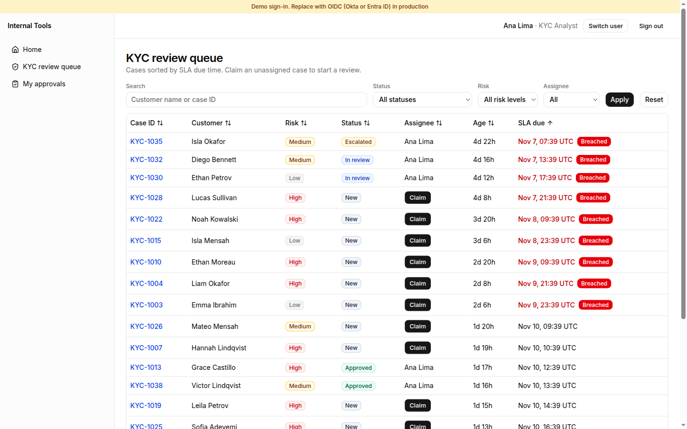

# Internal tools platform: KYC review queue

A prototype showing that internal tools now built in Microsoft Power Apps can be built and owned in code without weakening compliance controls. It rebuilds the KYC review queue on a shared platform layer that provides sign-in, permissions, PII masking, two-person approval, and a tamper-evident audit log for every future tool.



## Overview

The company runs three internal tools on Power Apps: a KYC review queue, a refunds dashboard, and a feature-flag admin panel. Licenses cost about $250K a year and at least 10 more tools are planned. This prototype tests whether those tools can move to code, starting with the hardest one.

The prototype demonstrates these controls:

- Role-based access, checked on the server for every page and every write
- PII masked by default, with a reveal that requires a reason and is logged
- Two-person approval on High-risk cases
- An append-only audit log with a SHA-256 hash chain and a "Verify integrity" check
- A registry that drives the home page and navigation, so each new tool is one folder and one entry

All data is fake. This is not production software.

| Power Apps | This prototype |
| --- | --- |
| Entra ID sign-in | Demo sign-in behind one auth module, ready to swap for OIDC |
| Dataverse security roles | One permission map, checked on the server |
| Field-level security | PII masked by default, with a logged reveal |
| Dataverse auditing | Append-only audit log with a hash chain to detect tampering |
| Power Automate approvals | Shared approvals module that enforces a two-person rule |
| Model-driven views and forms | Shared table, detail layout, and decision panel |
| The app list | App registry that drives the home page and navigation |
| Solutions and pipelines | Git, pull requests, and CI |

## Getting started

Prerequisites: Node 24 LTS and npm 10 or later. The version is pinned in `.nvmrc` and `package.json`.

The same commands work on macOS, Windows, and Linux:

```
npm install
npm run db:reset
npm run dev
```

Then open http://localhost:3000. There is no `.env` file to copy. The database is a local SQLite file at `prisma/dev.db`, and `npm run db:reset` recreates it with the seed data at any time.

The default session secret is for the demo only. To override the defaults, set `DATABASE_URL` and `SESSION_SECRET`.

## Demo

The sign-in page lists four fake users. Use "Switch user" in the header to change roles.

| User | Role | What they can do |
| --- | --- | --- |
| Ana Lima | KYC Analyst | Claims cases, decides them, and gives the first approval on High-risk ones |
| Marcus Reed | Compliance Lead | Gives the second approval on High cases, approves or rejects escalated cases, and can reveal PII |
| Priya Shah | Support Agent | Has no KYC access, which shows the permission checks at work |
| Sam Park | Platform Admin | Reviews the audit log and checks its integrity. KYC case pages are read-only for Sam |

| Permission | KYC Analyst | Compliance Lead | Support Agent | Platform Admin |
| --- | --- | --- | --- | --- |
| `kyc:view` | yes | yes | no | yes |
| `kyc:claim` | yes | no | no | no |
| `kyc:decide` | yes | yes | no | no |
| `kyc:approve_high_risk` | no | yes | no | no |
| `kyc:reveal_pii` | no | yes | no | no |
| `audit:view` | no | yes | no | yes |
| `audit:verify` | no | no | no | yes |

Walkthrough:

1. Sign in as Ana, filter to unassigned High-risk cases, and claim one
2. Open the case, note the masked SSN, review the screening hits, and approve it
3. Confirm the case is waiting for a second approval
4. Sign in as Marcus, open "My approvals," reveal the SSN with a reason, and approve
5. Open the case history to see both decisions and the reveal
6. Sign in as Priya and confirm that KYC is hidden and that its URL returns 403
7. Sign in as Sam, open the audit log, and run "Verify integrity"

To see tamper detection, edit any row in the `AuditEvent` table of `prisma/dev.db` with a SQLite tool, then run "Verify integrity" again. It reports the first broken event.

## Project structure

```
src/
  app/                 Next.js routes: sign-in, shell, home, My approvals, audit log, 403 page
  platform/            Controls every tool reuses
    auth/              Demo sign-in with a signed HTTP-only cookie
    rbac/              Permission map, can(), requirePermission(), page and action guards
    audit/             recordAudit(), hash chain, verifyAuditChain(), history timeline
    pii/               Masking and the reason-gated reveal
    approvals/         requestApproval(), decideApproval(), the two-person rule
    components/        Server-side data table, status badge, detail layout, decision panel, reason dialog
  apps/
    registry.ts        Installed and planned tools; drives the home page, sidebar, and routing
    kyc/               KYC review queue: rules, service, actions, queries, pages
prisma/
  schema.prisma        Users, audit events, approvals, KYC cases, documents, screening hits
  seed.ts              4 users and 40 fake cases
tests/                 Vitest tests
.agents/skills/new-internal-tool/SKILL.md   Step-by-step guide to adding a tool
AGENTS.md              Rules every change follows
```

## Testing

```
npm test
npm run lint
npm run typecheck
```

Tests run against a throwaway SQLite database per test file. They cover the permission map, server-side denials, the two-person rule, audit chain tamper detection, masking and reveals, and every KYC status change. GitHub Actions runs lint, typecheck, tests, and a production build on Ubuntu, macOS, and Windows for every pull request.

## Adding a tool

Each tool lives in `src/apps/<tool-id>` and has one entry in `src/apps/registry.ts`. The entry sets the tool's name, path, icon, and required permission. The home page, sidebar, and router read the registry, so the shell does not change. The refunds dashboard and feature-flag admin are already registered as planned tools, which appear as greyed-out tiles.

`.agents/skills/new-internal-tool/SKILL.md` walks through the steps with this repo's real paths and functions: models and seed data, permissions, registration, pages from the shared components, audited writes, masking, approvals, and tests. `AGENTS.md` holds the rules every change must follow. Devin or an engineer can follow both to build the next tool.

## Limitations and next steps

What is mocked today:

- Sign-in is a demo user picker. Swap `src/platform/auth` for OIDC with Okta or Entra ID
- All customers, documents, and screening hits are seed data. Screening lists are fictional
- Files are listed by name only; there is no document storage or viewer

What production would need:

- Real SSO with group-to-role mapping
- Postgres with backups instead of SQLite
- Write-once audit storage, such as an object store with retention locks, plus a periodic external anchor for the hash chain
- A deployment pipeline with environments and secrets management
- A security review and penetration test

Next tools to build with the Skill:

1. Feature-flag admin panel, with production changes routed through the approvals module
2. Refunds dashboard, with refunds above a threshold requiring two-person approval

Other additions worth making:

- Notifications for pending approvals and SLA breaches
- A real screening vendor integration
- Migrating open cases and history from Dataverse
